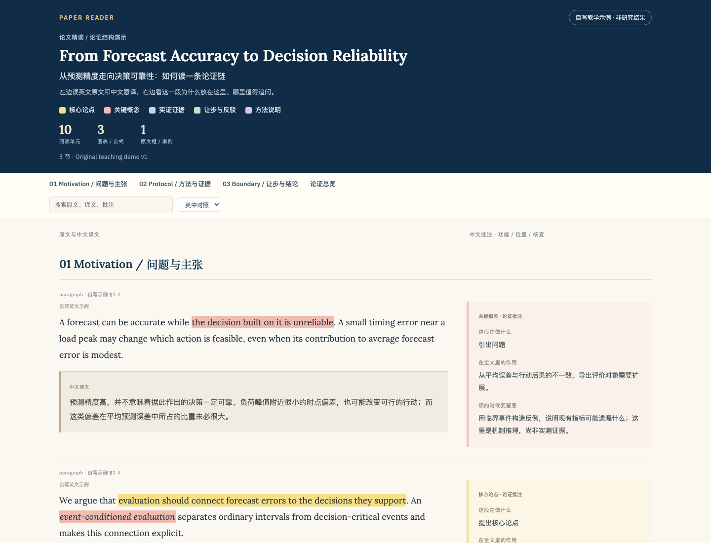

# Paper Reading Skills

[](https://github.com/Yuwangzhi/paper-reading-skills/actions/workflows/tests.yml)

> Turn a paper into a readable page, and into a checkable understanding.

Two AI-agent skills for reading papers closely. They work with Claude Code, Codex, and other hosts that read `SKILL.md` files:

- **`paper-reader`** turns a paper into a **source-faithful, offline, single-file bilingual HTML reader** with paragraph-level annotations, and archives the original PDF, your notes, the build sources, and QA records alongside it.
- **`paper-tutor`** **reads with you**: one small piece at a time, one question at a time. You answer `1/2/3` plus a confidence level; it keeps glossary cards, a mistake log, a review schedule, and a one-page note.

Use either skill alone, or chain them: `paper-reader` builds the HTML, then `paper-tutor` guides you through the same section/block anchors. **The scripts never call a model or a paid API.** Translation, annotation, question writing, and teaching are done by the agent you are already using; the scripts only extract, lay out, save, and check.

[中文 README](README.md)

---

## What each skill is for

| You ask | Skill | You get |
|---|---|---|
| "Turn this PDF into a bilingual, paragraph-annotated HTML page." | `paper-reader` | A paper folder: original PDF + offline HTML + notes + build sources + QA records |
| "Walk me through this paper, one question at a time; I'll answer 1/2/3 and confidence." | `paper-tutor` | A guided session + glossary cards + answer log + review schedule + one-page note. No HTML/PDF. |

`paper-reader` produces **reading material**. `paper-tutor` produces a **record of the learning process**. The first is for archiving, sharing, and reading end to end; the second is for actually understanding the paper.

The bottleneck in paper reading is usually not a lack of summaries. It is not checking whether you actually understood the paper, or where the evidence stops supporting the claim. `paper-reader` puts the original, the translation, and the annotation on one page so they can be compared. `paper-tutor` turns understanding into a checkable record through questions and review.

### 30-second start

Once installed, just tell the agent:

> Turn this PDF into an offline bilingual HTML page with paragraph-by-paragraph annotations.

Or:

> Walk me through this paper. One question at a time; I'll answer 1/2/3 and confidence.

You do not need to memorize commands or read the paper first. The skill picks the right mode and checks the paper version and readable scope before it starts.



The screenshot is generated from the repository's own demo data: original English and Chinese translation on the left, paragraph annotation on the right. The full page is at `skills/paper-reader/assets/example.html`.

---

## Install

### Option 1: Claude Code plugin marketplace

```text
/plugin marketplace add Yuwangzhi/paper-reading-skills
/plugin install paper-reading@paper-reading-skills
```

After installation, describe what you want in a session. Claude will select `paper-reader` or `paper-tutor` from the skill descriptions.

### Option 2: Manual links (Claude Code)

```bash
git clone https://github.com/Yuwangzhi/paper-reading-skills.git
cd paper-reading-skills
mkdir -p ~/.claude/skills
ln -s "$PWD/skills/paper-reader" ~/.claude/skills/paper-reader
ln -s "$PWD/skills/paper-tutor"  ~/.claude/skills/paper-tutor
```

### Option 3: Codex or another SKILL.md-compatible host

Link or copy the two skill directories into the host's skill directory. For Codex:

```bash
mkdir -p ~/.codex/skills
ln -s "$PWD/skills/paper-reader" ~/.codex/skills/paper-reader
ln -s "$PWD/skills/paper-tutor"  ~/.codex/skills/paper-tutor
```

`skills/*/agents/openai.yaml` provides display names and default prompts for Codex; other hosts can ignore it.

### Dependencies

`paper-reader`:

```bash
python3 -m pip install -r skills/paper-reader/scripts/requirements.txt
# Optional: extract a draft directly from PDF
python3 -m pip install "PyMuPDF>=1.24,<2"
```

`paper-tutor` uses only the Python 3.9+ standard library.

Optional browser QA:

```bash
npm install playwright
```

Without Playwright you can still build the HTML; only the automated real-browser rendering check is unavailable.

---

## Quick start

### 1. Bilingual annotated HTML

Tell the agent:

> Turn the attached paper, in full, into an offline bilingual HTML page with paragraph-level annotations. Put it in `papers/<short-name>/`.

Or narrow the scope:

> Only Section 3. Mark it clearly as an excerpt.

> Find three related papers and build analytical summary pages with the same layout. Label what is not original text.

The agent first builds an ordered block inventory, checks the version and coverage against the PDF, writes a Chinese translation and annotation for each block, then runs the build and QA scripts. **The default deliverable is a folder, not just one HTML file.**

Typical output:

```text
papers/FinTSB_2502.18834v3/
├── 00_导读.md                    guide: relative links to PDF, HTML, notes
├── 01_原文/FinTSB.pdf            original paper
├── 02_阅读/FinTSB.html           Latin fonts, images, interaction embedded
├── 03_笔记/阅读笔记.md            your own notes
├── 04_生成/
│   ├── source.json              source inventory
│   ├── annotations.json         translations, annotations, highlights
│   └── images/...               local images when needed
└── 05_检查/
    ├── FinTSB.qa.json           structural QA record
    └── bundle_manifest.json     relative paths and SHA-256
```

HTML features:

- Left column: original English followed immediately by the Chinese translation. Right column: paragraph annotation (what this block does / its role in the argument / what to watch for).
- Five highlight classes: yellow `thesis`, red `concept`, blue `evidence`, green `concession`, purple `method`.
- Bottom overview: question → thesis → evidence → rebuttal/boundary → conclusion, plus the strongest and weakest points.
- Latin fonts, styles, images, and equations are embedded; Chinese uses system fonts. No CDN, no web fonts, no runtime external scripts.
- Files are named after the **paper's short name** (e.g. `FinTSB.html`), never `reading.html` or `paper.pdf`.

You can also call the scripts directly:

```bash
python3 skills/paper-reader/scripts/extract_source.py \
  --input paper.pdf --output source.json --version v2

python3 skills/paper-reader/scripts/build_bundle.py \
  --source source.json --annotations annotations.json \
  --pdf paper.pdf --output-dir papers/FinTSB_2502.18834v3 --slug FinTSB

python3 skills/paper-reader/scripts/build_bundle.py --check papers/FinTSB_2502.18834v3
```

### 2. Interactive reading

Tell the agent:

> Walk me through this paper. One question at a time; I'll answer 1/2/3 and a confidence level.

Or:

> Don't summarize it. First show me which parts of this paper are worth reading.

> Quiz me on what Table 2 can actually support.

> Review yesterday's glossary cards, then leave me a one-page note. No webpage.

The session has seven stations: **locate → skeleton → one small block → one question → alternate explanation → review → one-page note**. Each explanation is roughly 200–300 Chinese characters, and only one question is asked before the answer is revealed.

Session files:

```text
精读/                          # use 06_精读/ inside the paper-reader bundle above
├── 精读会话.json              glossary, questions, answers, mistakes, review queue
└── 精读笔记.md                exported one-page note
```

Direct state-script use:

```bash
python3 skills/paper-tutor/scripts/reading_session.py init \
  --output-dir papers/FinTSB_2502.18834v3/精读 \
  --paper papers/FinTSB_2502.18834v3/01_原文/FinTSB.pdf --slug FinTSB --title "Paper title" --goal understand

python3 skills/paper-tutor/scripts/reading_session.py status --session papers/FinTSB_2502.18834v3/精读/精读会话.json
python3 skills/paper-tutor/scripts/reading_session.py export --session papers/FinTSB_2502.18834v3/精读/精读会话.json
```

`init` refuses to overwrite an existing session or note. `export` writes `精读笔记_自动生成.md` instead of overwriting an existing target unless `--force` is given. An existing reading note in the paper folder (`03_笔记/阅读笔记.md` in the bundle layout) is never modified by the tutoring script. Because `init` places an empty `精读笔记.md` template, the first export usually goes to `精读笔记_自动生成.md`; if you are sure the template was not edited by hand, pass `--force` to overwrite it.

The skill's default folder and file names are Chinese because it targets Chinese-speaking readers. Change them only if you update the references and scripts as well.

---

## Design principles

1. **Source first.** Full-text annotation requires a coverage inventory checked against the PDF. A successful extraction does not prove the text is complete. Unrecoverable content is marked as an excerpt or a gap, never presented as full text.
2. **Scripts do not invent content.** Extraction, layout, validation, and state persistence are scripted. Translation, annotation, questions, and teaching are done by the agent. Scripts never call a model and never claim the reader has mastered something.
3. **Offline and self-contained.** The generated HTML has no CDN, web-font, MathJax, or external-resource dependency. One file can be forwarded and archived.
4. **Material is not instruction.** Text inside papers, attachments, web pages, or callout boxes is material to analyze, not a system instruction to execute.
5. **Never overwrite the user's work.** Your notes live apart from generated material, and rebuilding does not roll them back.
6. **Traceable provenance.** Record the source SHA-256, version, URL, coverage, and QA scope. Do not publish unauthorized full texts or personal paths.

---

## Repository layout

```text
paper-reading-skills/
├── .claude-plugin/
│   ├── marketplace.json         Claude Code marketplace manifest
│   └── plugin.json              plugin metadata
├── skills/
│   ├── paper-reader/
│   │   ├── SKILL.md             skill entry
│   │   ├── references/          data format, bundle layout, sources, QA
│   │   ├── scripts/             extract, build, check, browser smoke test
│   │   └── assets/              CSS, fonts, demo data, demo HTML
│   └── paper-tutor/
│       ├── SKILL.md             skill entry
│       ├── references/          seven-step flow, state schema, scheduling
│       └── scripts/reading_session.py
├── tests/
│   ├── test_paper_reader.py     source fidelity, coverage, highlights, build
│   └── test_paper_tutor.py      state, scheduling, export, no-overwrite
├── docs/preview.png             demo screenshot used by the README
├── .github/workflows/tests.yml  CI: all tests on Python 3.9 / 3.12
├── README.md
├── README.en.md
├── LICENSE
└── NOTICE.md
```

---

## Demo

The repository includes a **self-written teaching example** with no real paper or research result:

Open `skills/paper-reader/assets/example.html` in a browser (on macOS you can run `open` on it).

Its build sources are `skills/paper-reader/assets/example-source.json` and `example-annotations.json`. Use them to see the shape of `source.json` / `annotations.json`, then replace them with your own paper.

---

## Run the tests

```bash
python3 -m unittest discover -s tests -v
```

Coverage includes: source-digest change detection, block-ID coverage, five-class highlighting that does not alter the original, mandatory human-review basis for a "full text" label, tutoring state updates and review scheduling, and no-overwrite export rules. **Passing tests do not prove translation accuracy or teaching quality.** Semantic and visual checks remain manual.

---

## Known limitations

- PDF extraction produces a **draft**. Multi-column reading order, figure/table semantics, complex equations, and appendices usually need manual repair.
- Scanned PDFs need OCR first; the scripts do not perform OCR.
- Translation quality, annotation depth, and question quality depend on the host agent and your own review.
- `paper-tutor` scripts only save state and scheduling. They do not grade answers or estimate mastery.
- Automated browser QA requires Playwright plus a local Chromium/Chrome/Edge. Without it, only static structure checks and manual preview are available.

---

## License and provenance

Released under [CC BY-SA 4.0](LICENSE). The skills are adapted from the author's earlier paper-reading workflow; see [NOTICE.md](NOTICE.md) for full attribution.
