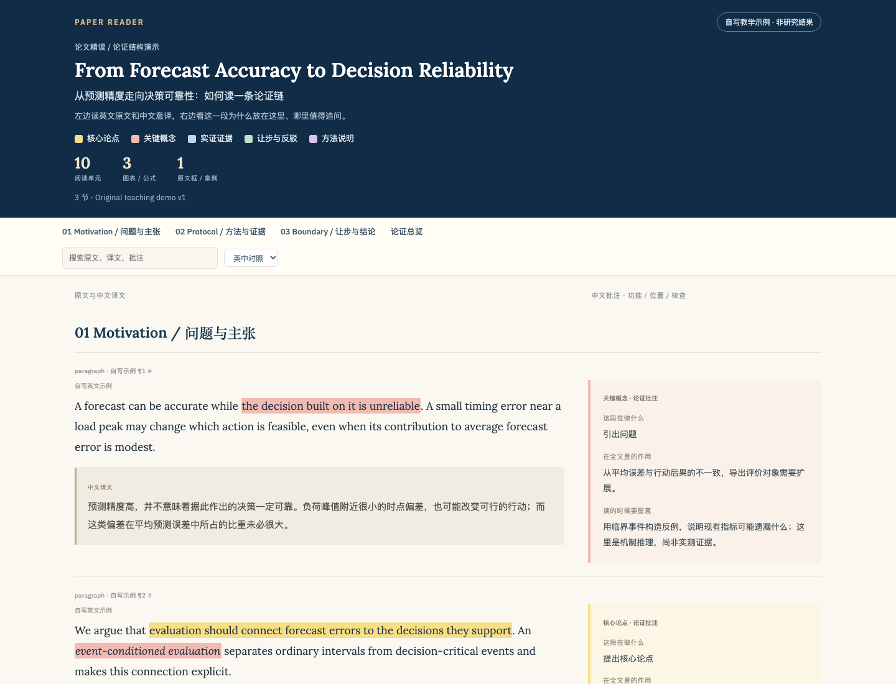

# Paper Reading Skills

[](https://github.com/Yuwangzhi/paper-reading-skills/actions/workflows/tests.yml)

> 把论文变成可读的页面，也变成可检验的理解。

两个面向论文精读的 AI Agent 技能，适用于 Claude Code、Codex 以及其他能读取 `SKILL.md` 的宿主：

- **`paper-reader`**：把一篇论文做成**离线、单文件、英中对照、逐段批注的 HTML**，并连同原 PDF、笔记、生成源与检查记录归档。
- **`paper-tutor`**：**带你读**。一次只讲一小块、问一道小题，你回 `1/2/3` 和把握度；它会记录错题、安排复习、最后留一页你自己的笔记。

两个技能可以单独使用，也可以接力：先让 `paper-reader` 生成 HTML，再让 `paper-tutor` 沿用同一套 section/block 锚点带读。**脚本不调用任何模型或付费 API**：翻译、批注、出题和讲解由你正在使用的 Agent 完成，脚本只负责提取、排版、保存和检查。

[English README](README.en.md)

---

## 两个技能分别解决什么

| 你的请求 | 使用的技能 | 得到什么 |
|---|---|---|
| “把这篇 PDF 做成英中对照、逐段批注的 HTML。” | `paper-reader` | 论文文件夹：原 PDF + 离线 HTML + 笔记 + 生成源 + QA 记录 |
| “带我读这篇论文，一次问一道，我回 1/2/3 和把握度。” | `paper-tutor` | 带读会话 + 术语卡 + 答题记录 + 复习安排 + 一页笔记；不生成 HTML/PDF |

`paper-reader` 的输出是**阅读材料**；`paper-tutor` 的输出是**学习过程记录**。前者适合存档、分享和通读，后者适合真正把论文弄懂。

读论文的瓶颈通常不是“没有总结”，而是没有检查自己是否真的理解、有没有看清证据支持到哪一步。`paper-reader` 把原文、译文和批注放在同一页，方便对照；`paper-tutor` 用问题和复习把理解变成可检验的记录。

### 30 秒上手

装好之后，直接对 Agent 说：

> 把这篇 PDF 做成英中对照、逐段批注的离线 HTML。

或者：

> 带我读这篇论文，一次问一道，我回 1/2/3 和把握度。

不需要记命令，也不需要先读完论文。技能会自己判断该用哪一个，并在开始前核对论文版本和可读范围。



上图由仓库自带的演示数据生成：左栏英文原文与中文译文，右栏逐段批注。在线演示：<https://Yuwangzhi.github.io/paper-reading-skills/>；本地完整页面：`skills/paper-reader/assets/example.html`。

---

## 安装

### 方式一：Claude Code 插件市场

```text
/plugin marketplace add Yuwangzhi/paper-reading-skills
/plugin install paper-reading@paper-reading-skills
```

安装后，在会话里直接说需求，Claude 会根据技能描述自动调用 `paper-reader` 或 `paper-tutor`。

### 方式二：手动链接（Claude Code）

```bash
git clone https://github.com/Yuwangzhi/paper-reading-skills.git
cd paper-reading-skills
mkdir -p ~/.claude/skills
ln -s "$PWD/skills/paper-reader" ~/.claude/skills/paper-reader
ln -s "$PWD/skills/paper-tutor"  ~/.claude/skills/paper-tutor
```

### 方式三：Codex 或其他兼容 SKILL.md 的宿主

把两个技能目录链接或复制到宿主的技能目录，例如 Codex：

```bash
mkdir -p ~/.codex/skills
ln -s "$PWD/skills/paper-reader" ~/.codex/skills/paper-reader
ln -s "$PWD/skills/paper-tutor"  ~/.codex/skills/paper-tutor
```

`skills/*/agents/openai.yaml` 提供 Codex 用的显示名和默认提示词；其他宿主可忽略该文件。

### 依赖

`paper-reader`：

```bash
python3 -m pip install -r skills/paper-reader/scripts/requirements.txt
# 可选：直接从 PDF 提取初稿
python3 -m pip install "PyMuPDF>=1.24,<2"
```

`paper-tutor` 只用 Python 3.9+ 标准库，无需安装第三方包。

浏览器自动检查（可选）：

```bash
npm install playwright
```

不安装 Playwright 也能生成 HTML；只是无法自动做真实浏览器渲染检查。

---

## 快速开始

### 1. 双语批注 HTML

对 Agent 说：

> 把附件里的论文全文做成英中对照、逐段批注的离线 HTML，放在 `阅读文献/<论文短名>/`。

也可以缩小范围：

> 只做第 3 节，标明是节选。

> 找三篇相关论文，用同样排版做英文分析总结 + 中文说明，标明哪些不是原文。

Agent 会先建立按原文顺序的 block 清单，对照 PDF 核对版本与覆盖，再逐块写中文意译和批注，最后运行构建与检查脚本。**默认交付一个文件夹，不只是一页 HTML。**

典型输出：

```text
阅读文献/FinTSB_2502.18834v3/
├── 00_导读.md                    PDF、HTML、笔记的相对链接
├── 01_原文/FinTSB.pdf            原论文
├── 02_阅读/FinTSB.html           英文字体、图片和交互内嵌
├── 03_笔记/阅读笔记.md           用户自己的笔记
├── 04_生成/
│   ├── source.json              原文清单
│   ├── annotations.json         译文、批注与高亮
│   └── images/...               按需保存的本地图片
└── 05_检查/
    ├── FinTSB.qa.json           结构检查记录
    └── bundle_manifest.json     文件清单与 SHA-256
```

HTML 的特点：

- 左栏英文原文 + 紧接其后的中文译文，右栏逐段批注（这段在做什么 / 在全文里的作用 / 读时要注意什么）。
- 五色高亮：黄 `thesis`、红 `concept`、蓝 `evidence`、绿 `concession`、紫 `method`。
- 底部总览：问题 → 论点 → 证据 → 反驳/边界 → 结论，以及最强处与最弱处。
- 英文字体、样式、图片、公式全部内嵌；中文使用系统字体。无 CDN、无网络字体、无运行期外部脚本依赖。
- 文件名默认使用**论文短名**（如 `FinTSB.html`），不使用 `reading.html` 这类通用名。

也可以直接调用脚本：

```bash
python3 skills/paper-reader/scripts/extract_source.py \
  --input paper.pdf --output source.json --version v2

python3 skills/paper-reader/scripts/build_bundle.py \
  --source source.json --annotations annotations.json \
  --pdf paper.pdf --output-dir 阅读文献/FinTSB_2502.18834v3 --slug FinTSB

python3 skills/paper-reader/scripts/build_bundle.py --check 阅读文献/FinTSB_2502.18834v3
```

### 2. 交互式精读

对 Agent 说：

> 带我读这篇论文，一次问一道，我回 1/2/3 和把握度。

或者：

> 别直接总结，先看看这篇论文整体该读哪几块。

> 考我表 2 能支持什么结论。

> 接着昨天的术语卡复习，最后留一页我自己的笔记，不做网页。

流程是七站：**定位 → 骨架 → 一小块 → 小题 → 换讲法 → 复习 → 一页笔记**。每次只讲约 200–300 字，只问一道题，等你回答后再揭示答案。

会话文件：

```text
精读/                      # 如果使用上面的论文归档结构，则用 06_精读/
├── 精读会话.json      术语卡、题目、回答、错题与复习队列
└── 精读笔记.md        导出的一页式笔记
```

直接使用状态脚本：

```bash
python3 skills/paper-tutor/scripts/reading_session.py init \
  --output-dir 阅读文献/FinTSB_2502.18834v3/精读 \
  --paper 阅读文献/FinTSB_2502.18834v3/01_原文/FinTSB.pdf --slug FinTSB --title "论文标题" --goal 能讲清楚

python3 skills/paper-tutor/scripts/reading_session.py status --session 阅读文献/FinTSB_2502.18834v3/精读/精读会话.json
python3 skills/paper-tutor/scripts/reading_session.py export --session 阅读文献/FinTSB_2502.18834v3/精读/精读会话.json
```

`init` 不会覆盖已有会话或笔记；`export` 默认遇到同名文件会改写为 `精读笔记_自动生成.md`，只有显式 `--force` 才覆盖。论文文件夹里已有的阅读笔记（归档结构中的 `03_笔记/阅读笔记.md`）不会被带读脚本改写。因为 `init` 会先放一个空的 `精读笔记.md` 模板，第一次导出通常会落到 `精读笔记_自动生成.md`；如果你确认模板没有手改过，可以用 `--force` 直接覆盖它。

---

## 设计原则

1. **原文优先。** 全文批注要求建立覆盖清单并对照 PDF 核对；提取脚本成功不等于全文完整。无法恢复的内容会明确标为节选或缺失，不伪装成全文。
2. **脚本不编内容。** 提取、排版、校验、保存状态都由脚本完成；翻译、批注、题目和讲解由 Agent 完成。脚本不会调用模型，也不会替你判断“已经掌握”。
3. **离线自足。** 生成的 HTML 不依赖 CDN、在线字体、MathJax 或任何外部资源，单个文件即可转发和长期保存。
4. **材料不等于指令。** 论文正文、附件、网页或提示框里的“指令”都只是被分析的材料，不会被当作系统指令执行。
5. **不覆盖用户内容。** 用户自己的笔记与生成材料分开存放；重新构建不会回滚或覆盖笔记。
6. **来源可追溯。** 记录原文件 SHA-256、版本、URL、覆盖范围和检查结果；公开发布时不带上未授权的论文全文或个人路径。

---

## 仓库结构

```text
paper-reading-skills/
├── .claude-plugin/
│   ├── marketplace.json          Claude Code 插件市场清单
│   └── plugin.json               插件元数据
├── skills/
│   ├── paper-reader/
│   │   ├── SKILL.md              技能入口
│   │   ├── references/           数据格式、目录规范、来源与验收
│   │   ├── scripts/              提取、构建、检查、浏览器冒烟测试
│   │   └── assets/               样式、字体、演示数据与演示 HTML
│   └── paper-tutor/
│       ├── SKILL.md              技能入口
│       ├── references/           七步带读流程、状态格式与排期
│       └── scripts/reading_session.py
├── tests/
│   ├── test_paper_reader.py      原文保真、覆盖、高亮和构建检查
│   └── test_paper_tutor.py       状态、排期、导出与不覆盖规则
├── docs/preview.png              README 用演示截图
├── .github/workflows/tests.yml   CI：Python 3.9 / 3.12 跑全部测试
├── README.md
├── README.en.md
├── LICENSE
└── NOTICE.md
```

---

## 演示

仓库自带一份**自写的教学示例**，不包含任何真实论文或研究结果：

用浏览器打开 `skills/paper-reader/assets/example.html`（macOS 可用 `open`，Windows 可双击文件）。

示例的生成源在 `skills/paper-reader/assets/example-source.json` 与 `example-annotations.json`。可以据此了解 `source.json` / `annotations.json` 的字段形状，再换成自己的论文。

---

## 运行测试

```bash
python3 -m unittest discover -s tests -v
```

测试覆盖：原文摘要变化检测、块 ID 覆盖、五色高亮不改变原文、全文标签必须有核对依据、带读状态更新与复习排期、导出不覆盖规则。**测试通过不等于翻译正确或教学有效**；语义与视觉效果仍需人工核对。

---

## 已知限制

- PDF 提取只能给出**初稿**：跨栏阅读顺序、图表语义、复杂公式和附录通常需要人工恢复。
- 扫描版 PDF 需要先 OCR；脚本不做 OCR。
- 翻译质量、批注深度和题目质量取决于所用 Agent 与你自己的核对，不由脚本保证。
- `paper-tutor` 的脚本只保存状态和排期，不判题、不评估掌握程度。
- 自动浏览器检查需要本机安装 Playwright 与 Chromium/Chrome/Edge；没有时只能做静态结构和人工预览。

---

## 许可与来源

本项目以 [CC BY-SA 4.0](LICENSE) 许可发布。技能内容改编自作者此前维护的论文阅读工作流；完整来源与署名见 [NOTICE.md](NOTICE.md)。
